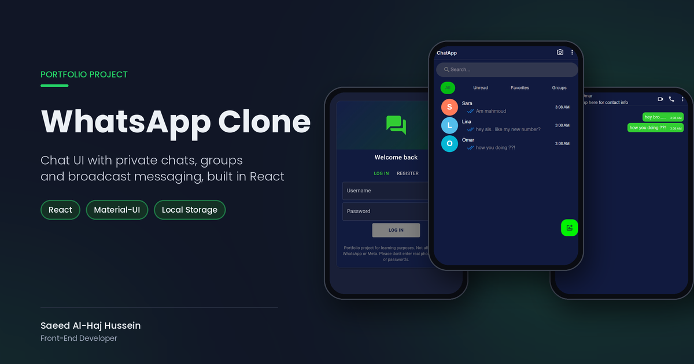

# 💬 WhatsApp UI Clone

A WhatsApp-style chat app built with React and Material UI: private chats, groups and messaging, all stored in the browser.

> **Note:** Portfolio project for learning purposes. Not affiliated with WhatsApp or Meta.

[](https://sa3ed-chatsapp-clone-project.netlify.app/)



## ✨ Features

- **Welcome & sign-up flow:** welcome screen, phone number step, then log in or register
- **Chat list with filters:** All, Unread, Favorites and Groups, plus search by name
- **Private chats:** messages are delivered to both people's threads, with timestamps
- **Group creation from existing chats:** pick contacts, set a group name and photo
- **Broadcast to group members:** a group message reaches every member's copy of the group, with the sender's name
- **Chat & group info pages:** contact details and status, group members with an admin badge, add/remove favorites, clear chat
- **Settings & profile:** edit your name, about text and phone number, upload a profile photo
- **Generated avatars:** users without a photo get their initial on a color that stays the same for them
- **Toast notifications** for actions such as adding chats, creating groups and saving your profile
- **Local Storage persistence:** everything survives a page reload, with no backend
- **Responsive:** full-screen on phones, centered phone-width layout on tablets and desktops

## 🗂️ How the data works

All data lives under a single `users` key in Local Storage:

- **Users array:** each user has an `userId`, name, number, status, profile photo and a **hashed** password (SHA-256 via the Web Crypto API; passwords are never stored in plain text).
- **Per-user chat lists:** every user has their own `userChats` array. A private chat stores the other person's `receiverId`. A group stores its `membersIds`, and every member gets a copy with the same chat ID.
- **Per-chat message threads:** each chat has its own `messages` array. Sending a message appends it to the sender's thread and to the receiver's (or every group member's) thread. Each message keeps a `senderId`, so the app knows which messages are yours.

## 🛠️ Tech Stack

| Technology                                  | Purpose                                  |
| ------------------------------------------- | ---------------------------------------- |
| [React 19](https://react.dev/)              | UI library                               |
| [Vite 7](https://vite.dev/)                 | Dev server and build tool                |
| [Material UI 7](https://mui.com/) + Emotion | Components and icons                     |
| [React Router 7](https://reactrouter.com/)  | Client-side routing                      |
| [uuid](https://github.com/uuidjs/uuid)      | Unique IDs for users, chats and messages |
| Web Crypto API                              | Password hashing                         |
| Local Storage                               | Data persistence                         |
| ESLint                                      | Linting                                  |

## 🚀 Getting Started

```bash
git clone https://github.com/Sa3ed-031/whatsapp-clone.git
cd whatsapp-clone
npm install
npm run dev
```

Then open the URL Vite prints, usually http://localhost:5173.

**Demo accounts** (seeded on first visit; enter any phone number with 5+ digits first):

| Username | Password |
| -------- | -------- |
| Ahmad    | ahmad123 |
| Lina     | lina123  |
| Omar     | omar123  |
| Sara     | sara123  |

To try messaging, log in as one user, add a chat using another demo user's name and number (e.g. `Lina` / `0933000002`), send a message, then log in as that user to see it arrive.

## 👤 Author

**Saeed Al-Haj Hussein**, Front-End Developer

- LinkedIn: [sa3ed-al-haj-hussein](https://www.linkedin.com/in/sa3ed-al-haj-hussein/)
- GitHub: [Sa3ed-031](https://github.com/Sa3ed-031)
- Portfolio: [sa3ed-portfolio.netlify.app](https://sa3ed-portfolio.netlify.app)
- Email: [saeedalhajwork@gmail.com](mailto:saeedalhajwork@gmail.com)

---

<p align="center">💼 Need a website for your business? <a href="mailto:saeedalhajwork@gmail.com">Let's talk!</a></p>
